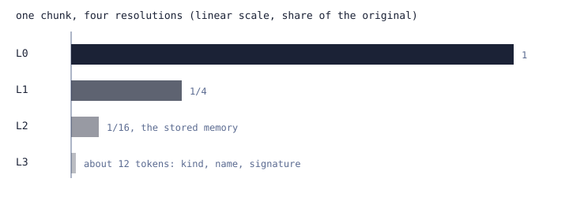
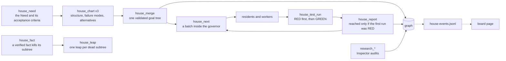
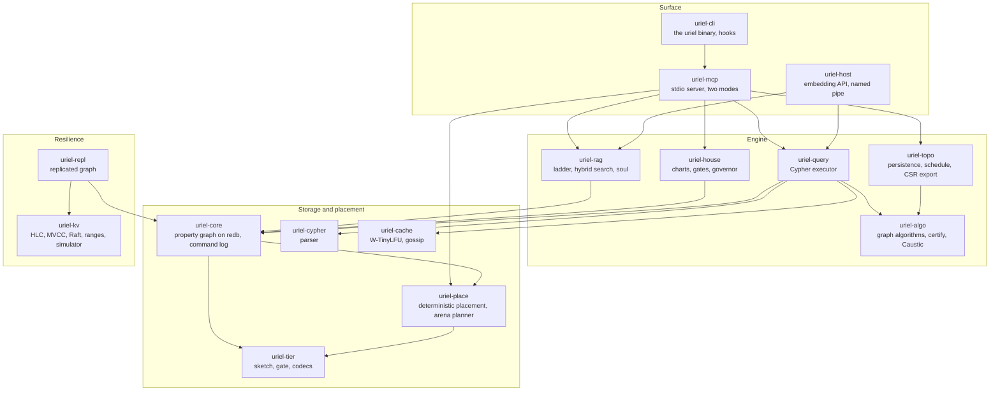

<p align="center"><b>Invented by <a href="https://teerthsharma.vercel.app/">Teerth Sharma</a></b> · <a href="mailto:teerths57@gmail.com">teerths57@gmail.com</a></p>

<p align="center">
  <picture>
    <source media="(prefers-color-scheme: dark)" srcset="assets/logo-lockup-dark.png">
    <source media="(prefers-color-scheme: light)" srcset="assets/logo-lockup-light.png">
    
  </picture>
</p>

<h1 align="center">Uriel</h1>

<p align="center"><b>Fewest tokens in, same information out.</b></p>

<p align="center">A model should read a small, well-lit view of everything it knows, and be able to zoom to the exact line.<br>
Uriel is the graph database, the scheduler and the retrieval engine that make that view, served over MCP from inside 60 MiB.</p>

<p align="center">
  
  
  
  
  
  
  
</p>

---

## Why

A model that researches your code is exactly as good as the context it is handed. The usual hand-off is a pile: chunk the corpus, paste the top hits at full length, and do it again on every turn, whether or not the model already read them. The window becomes the only memory, it is lossy, and every token in it is paid for twice, once in money and once in attention.

Uriel turns that around. The graph is the system of record. The context window is a *view* computed from it, at the lowest resolution that still answers, and every line in the view carries an address (`file:line`, a chunk id) that resolves to the exact original. Ask for more detail and you get it for one hit; ask the same question twice and the second answer costs a reference instead of a paragraph.

Three goals, in order:

1. **Save tokens.** Say less, in text the model can still read, with a way back to the full text.
2. **Be the best MCP for research.** Find the right chunk, remember what was learned, and survive the context window being compacted.
3. **Stay small.** The whole server, indexing included, runs inside one memory budget and peaks at 52.7 MiB in the release gate (a 60 MiB limit, a 50 MiB budget).

The name follows from the job. Uriel is the angel of light: the engine shines a small, chosen light on a large graph. In the mark, the flame is the budgeted view, the graph inside is the record, and node colour encodes the memory tier and nothing else (amber hot, orange warm, slate cold).

<p align="center"></p>

---

## See it work

Index a repository, ask one question with a token budget, then ask it again. This is `rag_search` against a snapshot of this repository's `crates/` (commit `c6d2563`, 6,481 chunks in 360 files, test fixtures excluded), with the compact encoding that is the default.

```text
#16 omit=2
@a=crates/uriel-core/src/tests/placed.rs
@b=crates/uriel-place/tests/gate_scan.rs
@c=crates/uriel-tier/src/cache.rs
@d=crates/uriel-cache/src/local.rs
>@a:488-503#1740L2+2
#[test]
fn a_100k_node_scan_keeps_a_100_node_h
>@b:51-56#4900L2 #[test]
>@c:436-443#6476L2 #[test]
>@d:640-658#771 fn tinylfu_keeps_hot_working_set_against_one_hit_scan()
>@a:441-449#1738 fn hot_set_through_scan(gate: bool) -> (usize, u64, u64)
>@b:58-72#4901 fn gate_off_lets_the_same_scan_flush_it()
 ...
```

The query was "admission gate keeps a scan from evicting the hot set". Sixteen hits fit in 400 tokens: the best at readable resolution, the rest as one-line gists, each with an address. The same call a second time returns

```text
#16 omit=2
>#1740L2r
>#4900L2r
>#6476L2r
>#771r
...
```

1,087 bytes became 152. `rag_expand` with a chunk id (`#771`) returns the original lines at any level from L3 (a gist) to L0 (verbatim). Reproduce with `uriel index <path> --db <db>`, then `rag_search` over `uriel mcp --db <db>`.

---

## Two modes

The server has exactly two modes, chosen at start. A normal server neither lists nor accepts a house tool; it answers a typed `wrong_mode` error that names the flag to restart with.

| | **normal** (default) | **house** |
|---|---|---|
| Flag | `--mode normal` or `URIEL_MODE=normal` | `--mode house` or `URIEL_MODE=house` |
| What it is | The cheap, fast mode: cached and stored context, a working RAG, one cited answer | Pure graph and harness engineering: a differential kept as a graph, with gates, charts and a resource governor |
| Sub-agents | Only mechanical readers, always on a strictly smaller model than the session (the contract of the `/seal` driver command; the server does not dispatch agents) | The charted fellows, residents and workers, scheduled by the harness |
| Tools | **27**: Cypher, memory, `rag_*`, `seal_remember` and `seal_recall`, `view`, `soul`, placement | **41**: the 27, plus 11 `house_*` and the 3 Inspector-only `research_*` tools |
| Read-only (`--read-only`) | 15 | 20 |

The tool counts are what `tools/list` returns at `7d74e6c`. Mode names appear in the scaffold fingerprint, so the two modes never share a stable prefix.

### Normal mode

Everything the model has learned lives in the graph, so a session starts warm. `rag_search` returns budgeted, cited hits; `rag_expand` zooms one; `seal_remember` stores a finding as a node linked to its source chunks; `seal_recall` finds remembered findings before the general index; `view` composes a whole context under a hard token budget; `soul` returns a short guide to the codebase. No fellows, no chart, no governor.

### House mode

House mode is for work that is disputed or heavy. The state is a graph (`Goal`, `Test`, `File`, `TestRun`, `Decision` nodes and the edges between them), and the board page is a mirror of it: the harness appends one JSON event per line to `house-events.jsonl` and the page redraws from that stream.



- **Charting.** Three stances chart a Need: structure (root cause, then parts), failure modes (guards that become test leaves) and alternative routes (each with a cost). The harness merges them by fixed rules: structure is the backbone, every failure mode becomes a test leaf under the goal it guards, and each set of alternatives keeps the cheapest one that no recorded fact refutes.
- **Validation.** A chart is rejected if it is not a tree, if `needs` form a cycle, if it is deeper than 6 or wider than 7, if a parent has one child, if a leaf lacks a tier, test command or estimate, if two unordered leaves write the same file, or if a path neither exists nor is declared as created. Each rule is a unit test.
- **The RED-first gate.** A goal counts as reached only if its bound test was RED on its first recorded run and is GREEN on the latest. `house_report` refuses anything else.
- **The governor** runs on every scheduling call:

```math
\text{slots}(c) = \min\!\left(\text{cap}(c),\ \left\lfloor \frac{\text{free\_ram} - \text{reserve}}{\text{cost}(c)} \right\rfloor\right), \qquad \text{reserve} = \max(2048\ \text{MB},\ 0.15 \cdot \text{total\_ram})
```

  Heavy classes (unit tests, builds) share a global cap of 6 and get 0 slots at or below the reserve; light classes and model calls keep running. Measured peak RAM of finished jobs updates each class's cost.
- **Inspector research.** `research_orbit_audit` and `research_pooling_audit` apply the deterministic, one-sided bounds of [Caustic](https://github.com/teerthsharma/caustic) (T1, T1\*, T2, T6, T6\*, T8) to claims about a relation. They can prove a claim impossible and never confirm one; `research_record` writes the verdict to the graph as an `AUDITED` edge from the goal.
- **Several Needs** share one database and one governor, namespaced `N2.G1.1`.

---

## Quick start

Requirements: Rust 1.90 or newer; Windows is the tested platform.

```powershell
cargo install --path crates/uriel-cli --locked
uriel doctor
uriel index . --db $HOME/.uriel/graph.uriel
```

`uriel install` registers the server with Claude Code for you and prints the exact command if `claude` is not on `PATH`. To register by hand, normal mode under the name `uriel`:

```powershell
claude mcp add uriel -s user -- uriel mcp --db $HOME/.uriel/graph.uriel
```

and house mode under the name `seal`:

```powershell
claude mcp add seal -s user -- uriel mcp --db $HOME/.uriel/graph.uriel --mode house
```

Both names can be registered, but they open the same database file, which has one writer: enable one of them at a time.

| Command | What it does |
|---|---|
| `uriel` / `uriel banner` | The flame banner (plain when `NO_COLOR` is set or stdout is not a terminal). |
| `uriel index <path> [--db]` | Chunks and indexes a directory; re-running is incremental. |
| `uriel mcp [--db --root --read-only --format compact\|json --placement local\|planned --mode normal\|house --terse off\|data\|prose --memory-mib N]` | The stdio MCP server. Never writes the banner. Default memory budget 50 MiB, minimum 16. |
| `uriel calibrate [--secs]` | Measures this machine's memory-latency staircase and suggests a hot-tier size. |
| `uriel doctor [--db]` | Checks the database directory is writable, free RAM, and the large-page privilege. |
| `uriel install` | Registers the server with Claude Code. |
| `uriel capture [--db --session --transcript]` | Stores a Claude Code transcript in the graph as small fractions. |
| `uriel recall-context [--db --budget 1200 --capture]` | Prints the gists nearest the recent topic, as hook JSON. |

The default database path is `~/.seal/graph.seal`; pass `--db` everywhere to choose another.

### Surviving /compact

When Claude Code compacts a conversation, the detail is gone. Two hooks hand the transcript to Uriel first. `uriel capture` cuts each turn into fractions of about 600 tokens, runs them through the RAG and stores them as `ctx/<session>/<n>.md`; `uriel recall-context --capture` stores the compaction summary and, in the new window, prints the gists nearest the recent topic as `file:line` citations that `rag_expand` zooms. Both commands exit 0 on every error, so a hook never blocks a session. The settings block is in [`docs/claude-code-hooks.md`](docs/claude-code-hooks.md).

---

## How tokens are saved

Binary compression does not reduce tokens; a compressed frame is not readable text. Tokens fall only by saying less in text the model can still read, so the token levers are textual, each with a decoder or an exact-original path:

1. **Resolution ladder.** Every chunk is stored at four resolutions (the figure above). `rag_search` packs a budget top-down, never over budget and never dropping a hit before every hit has been reduced to a gist; `rag_expand(chunk, level)` zooms one.
2. **Compact encoding.** Result tables come back as one header and value lines, with path aliases (`@a=crates/uriel-core/src/`), run markers, a value dictionary for repeated cells, and line ranges as `32-36`. `format=json` stays available everywhere. The decoder round-trips 2,000 random tables, survives 20,000 adversarial inputs, and refuses expansion bombs.
3. **Session dedup.** A chunk already delivered returns as `#1740` with a flag, and a changed one returns with its text again. `session_reset` clears it.
4. **A stable prefix.** The json result of `view` and `soul` opens with a byte-stable scaffold preamble keyed to the tool schemas, the output contract and the mode, so a prompt cache can reuse it across queries. The idea follows the owner's stable-scaffold work on NeMo-Relay (see Lineage). On the 100 frozen queries, 29,200 of 165,239 bytes of `view` output (17.7 %) are identical across queries.
5. **Terse results** (`--terse data|prose`, default off). `data` returns JSON results in a lossless compact text encoding that the server describes in its instructions and only keeps when it is shorter and decodes back to the same value; `prose` also shortens the wording of returned findings and of documentation sections in the soul guide. Stored data is never altered, `rag_expand` stays byte-exact, and `terse_stats` reports the tokens saved. Measured on 30 calls against this repository's index: at default formats `data` saves 3.5 % and `prose` 3.7 % of the total, because the compact `rag_search`, `view`, `soul` and Cypher output is already lean; results that have no compact form (graph, house, research, schema) shrink 13.9 %; for a caller that asks for `format=json`, `data` cuts 25.5 % against raw JSON.
6. **Capture and recall** (above) carry what compaction would drop.

### Retrieval

Retrieval follows the shape of [CLaRa](https://arxiv.org/abs/2511.18659) and drops the trained parts. Documents are compressed to about 1/16 by an extractive compressor (signatures, doc comments, salient lines); search fuses BM25 with a 256-dimensional hashed n-gram embedding stored as int8; the top 200 are reranked by BM25 over the stored full text; one to two hops of graph expansion add callers, tests and decisions; a bounded utility prior, fed by `rag_feedback`, raises chunks that were used and lowers chunks that were not. No GPU, no model download, deterministic. On the 100 frozen queries (207 files, 3,534 chunks, corpus SHA-256 pinned) recall at 5 is 1.000, the same as BM25 over the full chunk text, and the stored memories are 16.4x smaller than the text.

### View, islands, soul

`view` builds a whole context under a hard budget. Candidates are ordered into blocks, selected by the `uriel-topo` schedule (the first block as sink, the last two as the local window, the blocks nearest the focus as relevant) and rendered through the ladder; the same arguments return the same bytes. It can group candidates into **islands**, connected components found with a union-find that labels each island by its smallest id. Islands are off by default, and that is a measured result: on the frozen queries they lift the `view` tool's recall at 5 from 84 to 92 to 94 of 100 and also raise the mean response from 148.6 to between 196.4 and 274.6 proxy tokens (32 to 85 %, by budget), which is the wrong trade for a tool whose job is fewer tokens, so `islands=true` is opt-in.

`soul` returns a short guide to the indexed codebase: query-free salience (documentation density, definitions, rare vocabulary) refined by seeded, deterministic score diffusion along next-chunk and definition-to-mention links, packed through the ladder and cached in the graph by chunk fingerprint. The honest result: at the default budget of 1,200 tokens the guide contains the answer chunk of 3 of the 100 frozen queries, against 2 for a plain top-by-salience selection of the same size (chance is 1.3); at 4,000 tokens both contain 7. It does not beat the plain baseline, so it is a reference guide for orientation and not a retrieval method.

---

## Under the view: a graph database

The record is an embedded property graph on [redb](https://github.com/cberner/redb): labels, typed relationships, indexes, unique and existence constraints enforced on the write path, ACID transactions with one writer and many readers, and an openCypher engine (a hand-written Neo4j 5 dialect parser whose AST prints back to source and re-parses identically).

```text
 read ─→ T0 HOT   decoded records, bounded by entry count
           │ miss
           ▼
         T1 WARM  lz4 blocks in RAM, bounded by a byte budget
           │ miss
           ▼
         T2 COLD  redb file, zstd-19 values (authoritative)
```

- **A gate, not just a cache.** A record enters T0 only if its estimated frequency (a count-min sketch with periodic halving, TinyLFU) beats the entry it would evict, so a one-pass scan cannot flush the hot set.
- **One budget.** `--memory-mib` (default 50) is split in fixed shares: unmanaged reserve 25 %, redb page cache 25 %, RAG index 24 %, hot tier 8 %, warm tier 8 %, query cache 8 %, session 2 %.
- **A deterministic scheduler.** `uriel-place` decides which regions are hot, warm or cold as a pure function of an ordered event log: integer fixed-point scores, a logical clock instead of wall time. Shuffling arrival across threads changes nothing; `replay` returns the SHA-256 of the decision sequence. It also contains a gap-aware best-fit arena planner (lineage below).
- **Topology as layout.** `uriel-topo` computes 0-dimensional persistence over block centroids, a causal `SINK + LOCAL + RELEVANT` context schedule, and a topology-sorted node layout. The schedule exports as a block-sparse CSR (`UCSR` v1) for a Triton attention kernel; a parity harness checks the exported mask against that kernel on a GPU. The topological salience term itself lost to plain top-k in the needle-recall evaluation, so it is not wired into retrieval.
- **Integrity.** Every record carries a CRC-32C; `scrub` reports a changed record and drops the graph to read-only; `repair_from` restores it from a replica. Degraded modes (Full, ReadOnly, CacheOnly) have deterministic transitions, and every write boundary of a 500-operation workload reopens to a committed prefix.

### The distributed layer

`uriel-kv` is a sans-IO resilient core, driven by messages and ticks, with no sockets or threads, so a seeded simulator can break it:

| Piece | What exists |
|---|---|
| Clock and versions | Hybrid logical clock with a bounded-skew check; MVCC store with repeatable snapshots and garbage collection at a horizon |
| Raft | Election with PreVote and check-quorum, log replication with conflict hints, the current-term commit rule, snapshots and compaction, single-step membership change, ReadIndex; a file-backed log with CRC-32C records, torn-tail and crash recovery |
| Ranges | Descriptors, split by size, merge, a lease table with epochs, and a fuzzed wire codec, as data structures |
| Simulator | Seeded delay, drop, duplication, reorder, partition, kill, restart and disk faults, checking invariants after every step |
| Graph command log | `uriel-core` records each commit as a checksummed batch of commands with explicit ids; `uriel-repl` applies batches on every replica of one Raft group |

The shipped server runs a single node. Ranges are not yet wired to Raft groups, there are no distributed transactions, and Raft has been exercised in simulation only. The target is the layering of CockroachDB (clock, MVCC, ranges, Raft), with no compatibility or performance claim. [`PLAN.md`](PLAN.md) lists what is staged.

### Embedding

`uriel-host` embeds the engine in a host process such as an IDE: the same query, search and index operations over length-prefixed binary frames on in-process channels, loopback TCP or a Windows named pipe, with a frame cap, graceful drain on shutdown and a fuzzed decoder. The host is built for the Epsilon IDE, which Uriel serves; Python adapters (`crates/uriel-host/clients/`) expose it through the Clara oracle interface.

---

## Tools

**Both modes (27).**

| Group | Tools |
|---|---|
| Cypher | `get_neo4j_schema`, `read_neo4j_cypher`, `write_neo4j_cypher` |
| Memory graph | `create_entities`, `create_relations`, `add_observations`, `delete_entities`, `delete_observations`, `delete_relations`, `read_graph`, `search_memories`, `find_memories_by_name` |
| Retrieval | `rag_index`, `rag_search`, `rag_expand`, `rag_feedback`, `seal_remember`, `seal_recall`, `session_reset` |
| View | `view`, `soul` |
| Placement | `calibrate`, `why_hot`, `pin`, `unpin`, `replay`, `tier_stats` |

**House mode only (14 more, 41 in total).**

| Group | Tools |
|---|---|
| Differential | `house_need`, `house_chart`, `house_merge`, `house_fact`, `house_next`, `house_report`, `house_test_run`, `house_leap`, `house_status`, `house_select_tests`, `house_config` |
| Inspector research | `research_orbit_audit`, `research_pooling_audit`, `research_record` |

With `--terse data` or `prose` one more tool, `terse_stats`, appears in each mode. `pin` and `why_hot` act on the placement model, which is live with `--placement planned`; under the default `local` policy they report that nothing was applied.

---

## Architecture



`uriel-sys` (capability-checked memory regions, large pages, a hot arena with CSR layout, IOCP reads) is the only crate with `unsafe`, 28 lines under `src/raw/`; `uriel-host` uses it for the hot arena. `uriel-terse` (lossless compact JSON and prose compaction) and `uriel-bench` (Criterion benches with an asserted regression ceiling) stand alone.

| Crate | One line |
|---|---|
| `uriel-core` | Embedded property graph on redb: ACID transactions, indexes, constraints, tiers, checksums and scrub, degraded modes, replicated command log. |
| `uriel-tier` | Tier policy with no I/O: count-min sketch, TinyLFU gate, hot cache, lz4 and zstd codecs, RAM budget. |
| `uriel-place` | Placement as a pure function of an event log, checkpoints, the cache-latency calibrator, and the gap-aware arena planner. |
| `uriel-cypher` / `uriel-query` | openCypher lexer, parser and AST; tree-walking executor with a tag-invalidated result cache. |
| `uriel-algo` | PageRank, Louvain, shortest paths and more on CSR projections; island labels; `certify` interval bounds and `stable` convergence from Aether-Lang; the Caustic bounds. |
| `uriel-cache` | W-TinyLFU cache, consistent-hash ring, gossip membership, TCP cache protocol. |
| `uriel-rag` | Trainless compress-then-retrieve: ladder, hybrid search, rerank, graph expansion, utility prior, soul guide, frozen eval corpus. |
| `uriel-topo` | 0-D persistence, causal context schedules, topology-sorted layout, CSR export for the Triton kernel. |
| `uriel-mcp` | The stdio server: tools, compact encoding, session dedup, stable prefix, modes. |
| `uriel-house` | The harness: chart validation and merge, scheduling under the governor, RED-first gating, event stream. |
| `uriel-kv` / `uriel-repl` | The sans-IO distributed core and the replicated graph over it. |
| `uriel-host` | Embedding API for an IDE host. |
| `uriel-sys` | Capability-checked memory, large pages, hot arena, IOCP reads. |
| `uriel-terse` | Lossless compact JSON and prose compaction, as a library. |
| `uriel-bench` | Per-operation benches and a self-calibrating regression gate. |
| `uriel-cli` | The `uriel` binary. |

---

## Evidence

Every row was produced on one machine (Intel Core i7-14700HX, 15.7 GB RAM, Windows 11) at code commit `7d74e6c` on 2026-10-18, release profile, and states what it is compared against.

| Claim | Result | Command |
|---|---|---|
| Memory budget | Full-server peak working set 52.7 MiB (idle 9.4, after `rag_index` 36.7, 100 searches 38.0, 20 views 38.1, 20 souls 52.7) against a 60 MiB limit and a 50 MiB budget | `cargo test --release -p uriel-cli --test rss -- --nocapture --test-threads=1` |
| Retrieval | Recall at 5 and at 10 on 100 frozen queries (207 files, 3,534 chunks): hybrid 1.000 / 1.000, BM25 over full chunk text 1.000 / 1.000, through `pack_ladder` 1.000 / 1.000; memories 16.37x smaller than the text | `cargo test --release -p uriel-rag --test quantised -- --nocapture` |
| Tokens, v1 to v2 | 2.74x fewer cl100k proxy tokens overall on 20 fixed queries (`rag_search` 3.05x, Cypher 2.47x; `rag_search` with session dedup 3.59x) | `python crates/uriel-mcp/tests/token_eval/eval.py --bin target/release/uriel-mcp.exe` (needs `tiktoken`) |
| Repeat search | 1,087 bytes, then 152 bytes for the same call (demo above) | `rag_search`, `budget_tokens` 400, twice in one session |
| Stable prefix | 29,200 of 165,239 bytes (0.177) of `view` output identical across queries; minimum per-response share 0.131; 0 bytes were guaranteed stable before the preamble | `cargo test --release -p uriel-mcp --test prefix_share -- --nocapture` |
| Islands | `view` recall at 5: 84/100 off; 92, 94, 94 on (budgets 300, 800, 4,000). Mean proxy tokens 148.6 off; 196.4, 257.6, 274.6 on | `cargo test --release -p uriel-mcp --test view_frozen_tool -- --nocapture` |
| Soul | Gold chunk inside the guide for 0, 3, 7 of 100 queries at budgets 300, 1,200, 4,000; plain top-by-salience of equal size 0, 2, 7; chance 0.34, 1.27, 3.99 (run after refreshing the corpus digest in `eval_queries.json`, see the workspace row) | `cargo test --release -p uriel-rag --test eval soul_guide -- --ignored --nocapture` |
| Terse | Total proxy tokens over 30 calls: 5,543 off, 5,350 `data` (-3.5 %), 5,340 `prose` (-3.7 %); with `format=json` 14,779 off, 11,009 `data` (-25.5 %) | `TERSE_MEASURE_ROOT=. cargo test --release -p uriel-mcp --test terse_measure -- --ignored --nocapture` |
| Tools | 27 in normal mode, 41 in house mode; 15 and 20 with `--read-only` | `tools/list` sent to `uriel mcp --db <db> [--mode house] [--read-only]` |
| Raft simulation | 50 seeds x 3,000 steps on 3 nodes and 20 seeds x 3,000 steps on 5 nodes with membership changes hold every invariant; a crash at every write boundary loses no committed entry; 124 `uriel-kv` tests pass | `cargo test --release -p uriel-kv` |
| Replicated graph | 30 seeds x 2,000 steps keep every replica equal and lose no acknowledged write; 6 seeded mutations are each caught | `cargo test --release -p uriel-repl --features mutations` |
| Crash safety | Every write boundary of a 500-operation workload reopens to a committed prefix | `cargo test --release -p uriel-core crash` |
| Determinism | 200 placement logs x 8 thread counts with shuffled arrival replay to the single-thread digest; a 40-leaf governor run replays to one digest 20 times | `cargo test --release -p uriel-place --test replay_gate` and `-p uriel-house --test replay` |
| Workspace tests | 2,040 passed, 3 failed, 9 ignored across 130 result lines (113 test binaries, 17 doc-test runs). The 3 failures are the `uriel-rag` frozen-corpus digest checks (`corpus_digest_matches_the_recorded_one`, `regenerating_reproduces_the_checked_in_query_file`, `a_drifted_corpus_is_refused`); the digest recorded in `eval_queries.json` matches neither the CRLF nor the LF form of the corpus in this checkout | `cargo test --release --workspace --no-fail-fast` |
| Lint and supply chain | Clippy clean with warnings denied; `cargo deny` licenses, bans and sources ok | `cargo clippy --workspace --all-targets --no-deps -- -D warnings`; `cargo deny check licenses bans sources` |

---

## Lineage

Uriel is built from the owner's own earlier work, and credits it.

- **[Aether-Lang](https://github.com/teerthsharma/Aether-Lang)**: a Rust runtime for topological ML (manifold embeddings, F2 persistent homology, a Lean 4 verified kernel). `uriel-topo` is its persistence idea applied to context; `certify.rs` (outward-rounded numerical bounds) and `stable.rs` (convergence detection) are ported from it.
- **Epsilon IDE** (private): the host Uriel serves. `uriel-host` and the Clara oracle adapters exist so that an IDE process can embed the engine without a server.
- **[Caustic](https://github.com/teerthsharma/caustic)**: hallucination detection from the orbit partition of a relation, with proved one-sided bounds. House mode's Inspector tools are its deterministic floors, ported as T1, T1\*, T2, T6, T6\*, T8.
- **Merged work that shaped the engine:**
  - [triton-lang/kernels#22](https://github.com/triton-lang/kernels/pull/22), the topology-derived sparse attention kernel (merged): the consumer of `uriel-topo`'s CSR export.
  - [NVIDIA/NeMo-Relay#481](https://github.com/NVIDIA/NeMo-Relay/pull/481), reuse of stable ACG scaffolds (merged), is the source of the stable-prefix idea; the earlier topology-aware ACG proposals [#282](https://github.com/NVIDIA/NeMo-Relay/pull/282), [#321](https://github.com/NVIDIA/NeMo-Relay/pull/321) and [#322](https://github.com/NVIDIA/NeMo-Relay/pull/322) (closed, not merged) are its design lineage.
  - [google-deepmind/mujoco#3396](https://github.com/google-deepmind/mujoco/pull/3396) and [google-deepmind/mujoco_warp#1541](https://github.com/google-deepmind/mujoco_warp/pull/1541), linear-memory island discovery (both merged): the approach behind `island_labels`, a union-find that labels each island by its smallest id.
  - [google/XNNPACK#10801](https://github.com/google/XNNPACK/pull/10801), reuse of leading gaps in the memory planner (merged), and [pytorch/pytorch#200588](https://github.com/pytorch/pytorch/pull/200588), gap-aware offsets in Inductor memory planning (proposed, open): the arena planner in `uriel-place`.

## Prior art

| Work | What Uriel takes from it |
|---|---|
| **CLaRa** (Apple), [arXiv 2511.18659](https://arxiv.org/abs/2511.18659) | Compress documents to about 1/16, retrieve in the compressed space, expand on demand. Uriel replaces the learned parts with an extractive compressor, hashed vectors and a bandit-style utility prior. |
| **StreamingLLM**, Xiao et al. | The sink-plus-local shape of the context schedule, applied to retrieval scheduling. |
| **Raft**, Ongaro and Ousterhout | The consensus algorithm in `uriel-kv`: PreVote, the current-term rule, snapshots, single-step membership. |
| **TinyLFU** (Einziger, Friedman, Manes) | Frequency-sketch admission in `uriel-tier`, `uriel-place` and `uriel-cache`. |
| **CockroachDB** | The layering (HLC, MVCC, ranges, Raft) that `uriel-kv` follows. |
| [**redb**](https://github.com/cberner/redb), [**zstd**](https://github.com/facebook/zstd), [**lz4_flex**](https://github.com/PSeitz/lz4_flex) | The embedded store and the T2 and T1 codecs. |

The openCypher project defines the query language; networkx supplies the karate-club reference values.

---

## Design rules

1. **Deterministic.** Same input log, same output, independent of thread count and wall clock, each with a test.
2. **Bounded.** Every cache has a cap that is a constructor argument, and the server has one memory budget.
3. **`unsafe` is quarantined** in `uriel-sys`; every other crate denies or forbids it.
4. **No panics on adversarial bytes.** Every decode path is bounds-checked and fuzzed.
5. **Gate first, seen failing.** A gate is written and watched failing before the work lands, and mutation checks show the tests can fail.
6. **Evidence over assertion.** A number states what it was compared against.
7. **No comments in code.** Test names carry the meaning.

## License

Dual-licensed under **MIT OR Apache-2.0**, as declared in the workspace `Cargo.toml`.
