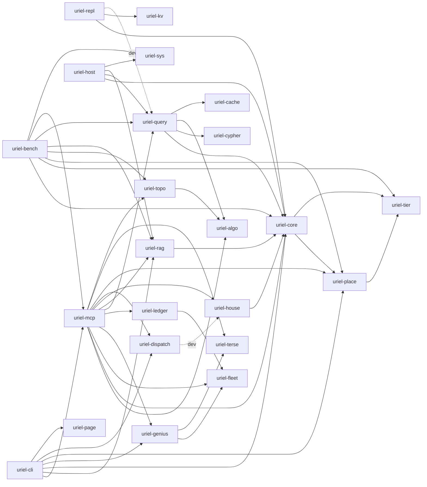

# Architecture

Uriel is an embedded property-graph database written in Rust. It runs openCypher queries, keeps a retrieval index over source files, and hosts the House, fleet, ledger and dispatch harnesses that coordinate agent work. The main entry point is an MCP server over stdio (`crates/uriel-mcp`), and a host process can embed the same engine through `uriel-host`.

This page maps the 23 crates under `crates/`, traces two MCP calls from stdin to stdout, and records the rules the code enforces: where `unsafe` is allowed, what determinism means in this workspace, how the platform layer falls back, and where a new tool has to be registered. The version is 0.2.9 (`Cargo.toml`). Some crate descriptions and the older design notes still say `seal`; this page uses the crate names as they appear in the workspace.

## Contents

- [Crate map](#crate-map)
- [Dependency graph](#dependency-graph)
- [Request path: `rag_search`](#request-path-rag_search)
- [Request path: `write_neo4j_cypher`](#request-path-write_neo4j_cypher)
- [Unsafe code policy](#unsafe-code-policy)
- [Determinism](#determinism)
- [Platform layer (`uriel-sys`)](#platform-layer-uriel-sys)
- [Build profile](#build-profile)
- [Adding an MCP tool](#adding-an-mcp-tool)
- [Trust boundaries](#trust-boundaries)
- [See also](#see-also)

## Crate map

The workspace members are listed in `Cargo.toml` under `[workspace]`. "Depends on" names workspace crates only. External dependencies are in each `crates/*/Cargo.toml`.

| Crate | Purpose | Key public types | Depends on |
|---|---|---|---|
| `uriel-core` | Embedded ACID property graph on `redb`: values, ids, transactions, label and property indexes, constraints, commit epochs, scrub and repair | `Graph`, `ReadTx`, `WriteTx`, `Node`, `Rel`, `Value`, `Props`, `MemoryBudget`, `Schema`, `Command`, `WriteBatch` | `uriel-place`, `uriel-tier` |
| `uriel-tier` | Storage-tier policy: TinyLFU gate, hot cache, value codecs (raw, lz4, cold zstd), tier controller, RAM budget. Described as having no I/O | `HotCache`, `Gate`, `Sketch`, `TierController`, `Budget`, `Codec` | none |
| `uriel-place` | Deterministic tier placement: a pure function of an ordered event log, with fixed-point scores and a logical clock; arena planner; cache-latency calibrator | `Placer`, `Config`, `Placement`, `Weights`, `Event`, `Region`, `Tier`, `Plan`, `Buffer` | `uriel-tier` |
| `uriel-cypher` | Hand-written openCypher (Neo4j 5 dialect) lexer, parser and typed AST with `Display` round trip | `parse()`, `Query`, `ParseError`, `Span`, `ast::*` | none |
| `uriel-query` | Cypher engine: analysis, tree-walking executor over `uriel-core`, result cache tagged by label and relationship type | `Engine`, `AccessMode`, `QueryResult`, `QueryStats`, `QueryError` | `uriel-core`, `uriel-cypher`, `uriel-algo`, `uriel-cache` |
| `uriel-algo` | Graph algorithms on immutable CSR projections: PageRank, Louvain, shortest paths, spanning trees, certified numerics, Caustic bounds | `Projection`, `ProjectionBuilder`, `PageRankConfig`, `LouvainResult`, `Path`, `Stable`, `Stop` | none (optional `rayon`) |
| `uriel-cache` | Distributed cache: W-TinyLFU local cache, consistent-hash ring, SWIM-lite gossip over UDP, length-prefixed TCP peer protocol | `LocalCache`, `Ring`, `DistCache`, `CacheNode`, `GossipConfig`, `Member` | none |
| `uriel-rag` | Retrieval over indexed files: chunking, extractive compression, BM25 plus int8 vectors, reranking, graph expansion, resolution ladder, the `soul` guide | `Rag`, `RagConfig`, `Hit`, `HitVia`, `SearchOptions`, `ContextPack`, `Level`, `Embedder`, `HashEmbedder`, `Soul` | `uriel-core` |
| `uriel-topo` | Topology of block centroids: 0-D persistence, context schedule, needle-recall evaluation, topology-sorted layout, CSR export | modules `persistence`, `schedule`, `layout`, `export`, `eval`, `measure`; re-exports `Error`, `Result` | `uriel-algo` |
| `uriel-sys` | Capability-checked memory regions, hot arena with CSR layout, async file reader, process memory and large-page metering. The only crate that contains `unsafe` blocks | `Arena`, `Cap`, `Region`, `HotCsr`, `AsyncReader`, `SysError`, `process_memory()` | none |
| `uriel-kv` | Sans-IO resilient KV core: hybrid logical clock, MVCC, Raft, ranges, deterministic cluster simulator | modules `hlc`, `mvcc`, `raft`, `range`, `sim`, `durable` (no root re-exports) | none |
| `uriel-repl` | Replicated property graph: one Raft range as a deterministic state machine over `uriel-core` | `Replica`, `BatchBuilder`, `Ack`, `Staged`, `Ticket`, `WriteError`, `Mutation` (feature `mutations`) | `uriel-core`, `uriel-kv`; dev: `uriel-query` |
| `uriel-terse` | Token-saving prose compaction and lossless compact JSON encoding | `compact`, `Level`, `scan`, `Span`, `Kind`, `count_tokens`, `estimate_tokens` | none |
| `uriel-page` | Page toolkit: a JSON spec becomes one self-contained static HTML file | `Page`, `Block`, `Theme`, `render`, `render_json`, `validate`, `PageError` | none |
| `uriel-fleet` | Agent fleet admission, hash-chained observation trace, input sanitiser and fence. No I/O | `Fleet`, `Deck`, `Launch`, `Limits`, `Trace`, `Event`, `sanitize`, `fence`, `Policy` | none |
| `uriel-ledger` | Bounded DAG of tiny goals: Kahn layers, ready frontier, JSON form `uriel.ledger.v1`. No I/O and no clock | `Ledger`, `NewGoal`, `State`, `AddReport`, `Error` | `uriel-fleet` |
| `uriel-genius` | Deterministic hexagonal abduction protocol: lens plans, claim validation, replayable verdict. No I/O | `Book`, `Claim`, `Plan`, `Options`, `Mode`, `Vertex`, `Outcome`, `Error` | `uriel-fleet`, `uriel-terse` |
| `uriel-house` | House-mode harness: validates and merges charts, schedules goals under a resource governor, accepts `Reached` only for a goal whose test was red on its first run | `House`, `HouseConfig`, `HouseError`, `EventSink`, `JsonlSink`, `SystemProbe`, `Batch` | `uriel-core` |
| `uriel-dispatch` | Deterministic router for team agents: gate, policy version, tickets, worker slots, as a replayable state machine | `Router`, `RouterConfig`, `Input`, `Effect`, `Policy`, `Ticket`, `Phase`, `replay()` | none; dev: `uriel-house` |
| `uriel-host` | Embedding API: engine in-process, framed binary protocol over channels, loopback TCP, or a Windows named pipe | `Host`, `HostConfig`, `Client`, `Transport`, `ChannelTransport`, `TcpTransport`, `PipeTransport` (Windows), `Request`, `Response`, `ErrorCode` | `uriel-core`, `uriel-query`, `uriel-rag`, `uriel-sys` |
| `uriel-mcp` | stdio MCP server: the tool table, two modes, guard, compact encoding, session dedup, view, soul, prefix, memory, House, fleet, ledger and dispatch tools | `Config`, `Context`, `ToolDef`, `Server`, `Db`, `Services` (library `uriel_mcp`, binary `uriel-mcp`) | `uriel-algo`, `uriel-core`, `uriel-fleet`, `uriel-genius`, `uriel-ledger`, `uriel-query`, `uriel-rag`, `uriel-house`, `uriel-dispatch`, `uriel-place`, `uriel-terse`, `uriel-topo` |
| `uriel-cli` | The `uriel` binary. Subcommands include `uriel mcp`, `uriel capture` and `uriel recall-context` (`PLAN.md` section B14). No library target | none (binary) | `uriel-mcp`, `uriel-rag`, `uriel-core`, `uriel-genius`, `uriel-place`, `uriel-dispatch`, `uriel-page` |
| `uriel-bench` | Criterion benchmarks and a latency regression gate. Not published | none re-exported; modules `hot`, `placement`, `query`, `retrieval`, `rng`, `store`, `table`, `topo`, `zipf` | `uriel-core`, `uriel-tier`, `uriel-place`, `uriel-topo`, `uriel-rag`, `uriel-query`, `uriel-mcp`, `uriel-sys` |

## Dependency graph

Arrows point from the crate that depends to the crate it depends on. Dashed arrows are dev-dependencies only.



- Ten crates have no workspace dependency: `uriel-tier`, `uriel-cypher`, `uriel-algo`, `uriel-cache`, `uriel-sys`, `uriel-kv`, `uriel-terse`, `uriel-page`, `uriel-fleet` and `uriel-dispatch`.
- `uriel-mcp` is the widest node, with 12 workspace dependencies. Everything a client can call is reached from it.
- `uriel-core` is the storage root. Query, retrieval, the host API and the replicated graph all sit on it.
- The House, fleet, ledger and genius crates are pure logic with no I/O. Their own descriptions say so, and `uriel-mcp` supplies the I/O.

## Request path: `rag_search`

This traces one `tools/call` request with `name: "rag_search"` from a line on stdin to the bytes written to stdout. Line numbers are from this checkout.

1. **Read.** `serve` (`crates/uriel-mcp/src/server.rs:297`) starts a reader thread. The thread calls `read_bounded` with `MAX_LINE_BYTES`, 8 MiB (`crates/uriel-mcp/src/guard.rs:13`), and sends each line over an `mpsc` channel. A longer line is discarded and answered with an `INVALID_REQUEST` error (`server.rs:335`).
2. **Parse.** `Server::reply` (`server.rs:134`) parses the line as JSON and accepts a batch array. `handle_message` (`server.rs:162`) checks `"jsonrpc": "2.0"` and the id type. `dispatch` (`server.rs:201`) routes `tools/call` to `tools_call` (`server.rs:242`).
3. **Resolve.** `tools_call` calls `tools::call` (`crates/uriel-mcp/src/tools.rs:401`). If that returns `None`, the client gets `Unknown tool` as an invalid-params error (`server.rs:247`).
4. **Gate.** `tools::dispatch` (`tools.rs:406`) looks the name up in `all()`. A `house_`, `research_`, `genius_` or `dispatch_` name in normal mode returns a `wrong_mode` error (`tools.rs:411`). A tool with `writes: true` returns an error under `--read-only` (`tools.rs:421`). `rag_search` is read-only, so it passes both checks.
5. **Route.** A name starting with `rag_`, `seal_` or `session_` goes to `rag_tools::call` (`tools.rs:435`), which matches `rag_search` at `crates/uriel-mcp/src/rag_tools.rs:434` and calls `rag_search` (`rag_tools.rs:483`).
6. **Options.** `rag_search` reads `query` through `req_str`. It builds `SearchOptions` with `k` (default `DEFAULT_K`, 8), `budget_tokens` (default `DEFAULT_BUDGET`, 2000), `expand_hops` (default 1) and `use_utility: true` (`rag_tools.rs:17-18`, `rag_tools.rs:485-490`). `Delivery::from_args` picks the output format, which defaults to the server's `--format`.
7. **Open the index.** `Context::rag` (`tools.rs:39`) calls `Services::rag` with the open database.
8. **Search.** `Rag::search` (`crates/uriel-rag/src/lib.rs:861`) does the following:
   - rejects `expand_hops` above `MAX_HOPS`, which is 2 (`lib.rs:40`);
   - embeds the query with the configured `Embedder`;
   - takes a read snapshot with `graph.begin_read()`;
   - runs the first stage: the in-memory index's `direct`, or `scan::direct` over the read transaction when `state.spilled` is set. The pool depth is the larger of `k` and `rerank::RERANK_DEPTH`;
   - reranks the pool with `rerank::rerank` (BM25 over the stored full text, `PLAN.md` section B9);
   - builds one `Hit` per id with `HitVia::Direct`, then adds graph neighbours with `HitVia::GraphNeighbour` when `expand_hops > 0`.
9. **Deliver.** `deliver` (`rag_tools.rs:329`) records the hit ids with `placement.observe_chunks`. Then it encodes the result. For compact format with the ladder on, `default_level` (`crates/uriel-rag/src/lib.rs:50`) gives rank 0 level L1, ranks 1 to 3 level L2 and the rest L3. The encoder shrinks the inner budget until the encoded text fits the proxy-token budget. If no hit fits the budget, the answer is `#0`. Delivered chunks are recorded in the session (`ctx.session.record`), so a later repeat comes back as a `#<chunk_id>` reference.
10. **Shape.** `tools::call` passes the text through `terse::shape` (`tools.rs:403`). `tools_call` then calls `guard.note_call`, and `guard::shape` applies the token limit (`server.rs:253-254`).
11. **Wrap.** The text is returned as `{"content":[{"type":"text","text":...}],"isError":false}` (`server.rs:255`).
12. **Write.** `serve` writes the response, a newline, any pending `notifications/tools/list_changed` message, and flushes (`server.rs:346-354`). An idle timeout calls `Server::release` (`server.rs:318-329`).

## Request path: `write_neo4j_cypher`

This traces one `tools/call` with `name: "write_neo4j_cypher"`. Steps 1 to 4 are the same as for `rag_search`, except that the gate uses `writes: true` (`tools.rs:212`).

1. **Route.** `tools::dispatch` matches the exact name `write_neo4j_cypher` (`tools.rs:434`) and calls `run_cypher(ctx, args, AccessMode::Write)` (`tools.rs:485`).
2. **Arguments.** `run_cypher` requires a non-empty `query`. `parse_params` converts `params` into `uriel_core::Value`. `ctx.db()` (`tools.rs:35`, backed by `crates/uriel-mcp/src/db.rs`) gives the open database, and `engine.execute(query, &params, Write)` runs the statement.
3. **Parse and classify.** `Engine::execute` (`crates/uriel-query/src/lib.rs:265`) parses with `uriel_cypher::parse`, which is where syntax errors stop the call. It calls `flush_dist` to apply pending distributed-cache invalidations (`lib.rs:243-262`). It asks `analyze::write_kind` whether the statement writes. An `EXPLAIN` statement returns a plan without running. A schema command goes to `schema::run_write`. Any other write goes to `Engine::run_write` (`lib.rs:313`).
4. **Open the transaction.** `run_write` calls `graph.begin_write()` (`crates/uriel-core/src/graph.rs:636`). `begin_write_with` refuses the call when the graph is read-only or not in full mode (`graph.rs:641`). It then waits on the single-writer gate (`acquire_writer`, `graph.rs:368`) and starts a `WriteTx`. A read snapshot is opened next to it, and `exec::run_top` runs the clauses. If any clause fails, the context is dropped and the transaction rolls back. The comment at `crates/uriel-query/src/lib.rs:321` says so.
5. **Commit.** `WriteTx::commit_recorded` (`crates/uriel-core/src/write.rs:177`) does the following:
   - if nothing changed, it aborts the transaction and returns the current epoch without calling subscribers (`write.rs:193-196`);
   - otherwise it writes the next ids, counts and `epoch + 1` to the `META` table (`write.rs:200-208`);
   - it commits the `redb` transaction (`write.rs:225`);
   - it calls `publish` (`write.rs:240`), which stores the new epoch and calls each subscriber (`graph.rs:383`);
   - it releases the writer gate (`write.rs:241`).
6. **Invalidate.** The subscriber that `Engine::from_graph` registered (`crates/uriel-query/src/lib.rs:192`) calls `invalidate_tag_before` for each touched label and relationship type, and for `*`. If a distributed cache is attached, it also queues the commit for `flush_dist`. Read results are cached under tags for the labels and types they touched, or `*` when they scanned unlabeled nodes (`lib.rs:40-46`).
7. **Reply.** `run_cypher` returns `stats_json` (`tools.rs:522`). The counters are `nodes_created`, `nodes_deleted`, `relationships_created`, `relationships_deleted`, `properties_set`, `labels_added`, `labels_removed`, `indexes_added`, `constraints_added` and `from_cache`. Steps 10 to 12 of the `rag_search` path then apply.

## Unsafe code policy

Only `uriel-sys` can contain `unsafe` code. Inside it, `unsafe` is confined to `src/raw/`: `raw/mod.rs`, `raw/win.rs` and `raw/winio.rs`. Every other crate either forbids or denies `unsafe_code`, except the three listed at the bottom of this section.

| Crate | Attribute | Location |
|---|---|---|
| `uriel-sys` | `#![deny(unsafe_code)]` and `#![deny(unsafe_op_in_unsafe_fn)]` | `src/lib.rs:1-2`; `#[allow(unsafe_code)] mod raw;` at `src/lib.rs:8` is the only allow in the workspace |
| `uriel-kv`, `uriel-mcp`, `uriel-place`, `uriel-topo` | `#![deny(unsafe_code)]` | `src/lib.rs:1` in each |
| `uriel-core` | `#![forbid(unsafe_code)]` | `src/lib.rs:47` |
| `uriel-query`, `uriel-rag`, `uriel-tier`, `uriel-house`, `uriel-dispatch`, `uriel-fleet`, `uriel-genius`, `uriel-ledger`, `uriel-page`, `uriel-terse`, `uriel-repl`, `uriel-host`, `uriel-bench` | `#![forbid(unsafe_code)]` | `src/lib.rs` (`uriel-tier` at line 2, `uriel-house` at line 11, `uriel-query` at line 54, `uriel-ledger` at line 10, the rest at line 1) |
| `uriel-cli` | `#![forbid(unsafe_code)]` | `src/main.rs:1` (the crate has no library target) |
| `uriel-algo`, `uriel-cache`, `uriel-cypher` | none | no crate-level attribute; a grep for the `unsafe` keyword in these three finds none |

Two notes on the table:

- `uriel-algo`, `uriel-cache` and `uriel-cypher` contain no `unsafe` today, but nothing in the build stops one from being added. `PLAN.md` method item 4 says `#![deny(unsafe_code)]` applies "everywhere except `uriel-sys`", which does not describe these three crates or the forbids listed above. The table is what the code has.
- Inside `uriel-sys`, the safe API takes validated ranges, not raw addresses. `Block::typed_span_checked` (`crates/uriel-sys/src/raw/mod.rs:201`) checks the byte range, the arithmetic overflow and the alignment before any read, write or slice is built. `PLAN.md` method item 6 states this as "hardware is reached only through capabilities".

## Determinism

`PLAN.md` method item 5 states the rule: the same input log gives the same output, independent of thread count and wall clock. Several crates are built to keep that rule, and the gates below check it.

Where the rule is enforced by design:

- `uriel-fleet`, `uriel-ledger`, `uriel-genius` and `uriel-tier` are described as having no I/O. `uriel-ledger` also has no clock (`crates/uriel-ledger/src/lib.rs:3-6`). `SAFETY.md` lists "no wall clock in any decision" as a practice for the fleet, genius and ledger crates.
- `uriel-place` computes placement as a pure function of an ordered event log, with fixed-point scores and a logical clock (its description in `crates/uriel-place/Cargo.toml`).
- `uriel-ledger` breaks ties in its topological order lexicographically, so the same goals give the same layers whatever order they were added in (`crates/uriel-ledger/src/lib.rs:3`).
- `uriel-dispatch` is described as a replayable state machine. `uriel-house` has a `replay` module and a decision digest.

Where the rule is checked by a test (figures as recorded in `PLAN.md`, with the date of each run):

- `crates/uriel-place/tests/replay_gate.rs`: 200 logs by 8 thread counts with shuffled arrival, 1,600 runs equal to the single-thread SHA-256 (2026-10-15, `PLAN.md` D1).
- `crates/uriel-topo/src/layout.rs`: the layout is identical over 8 runs and across thread counts (`PLAN.md` C4).
- `crates/uriel-house/tests/replay.rs`: a 40-leaf run replays to one digest 20 times, and a different temporary path gives the same digest (`PLAN.md` D5).
- `crates/uriel-kv/src/sim.rs`: the same seed gives the same trace (`PLAN.md` E4).

Exceptions, stated in the code and the registry:

- `calibrate` in `uriel-place` measures real cache latency, so its output depends on the machine. The registry records knees of 32 to 64 KiB, 2 to 4 MiB and 8 to 16 MiB on one run (`PLAN.md` D3).
- Queries that call `rand()` or `timestamp()` are never cached (`crates/uriel-query/src/lib.rs:46`).
- The last full workspace run recorded in `PLAN.md` (2026-10-18) had 3 failing frozen-corpus digest checks in `uriel-rag` (`PLAN.md` line 3). The workspace was not green on that run.

## Platform layer (`uriel-sys`)

Platform code is isolated in `crates/uriel-sys/src/raw/`, with `cfg(windows)`, `cfg(unix)` and `cfg(target_os = "linux")` gates. Callers see the same `Region`, `Arena` and `AsyncReader` types on every platform. What differs is which backend runs and what fallback it records.

| Concern | Windows | Linux | Other Unix (macOS, BSD) | Other targets |
|---|---|---|---|---|
| Page allocation | `VirtualAlloc` pages (`win::allocate_pages`) when alignment is at most the allocation granularity; larger alignment uses the standard allocator (`raw/mod.rs:91-132`) | Standard `alloc_zeroed` (`raw/mod.rs:134-138`) | Standard `alloc_zeroed` | Standard `alloc_zeroed` |
| Huge pages | Tried only when requested and the privilege is held. The privilege is enabled through the token API (`raw/win.rs:52-64`). The fallback reason is recorded: `PrivilegeMissing`, `AlignmentTooLarge`, `AllocationFailed` or `LargePagesUnsupported` | Not attempted; the fallback reason is `NotWindows` (`raw/mod.rs:136`) | Same as Linux | Same as Linux |
| File reads | `UnbufferedFile` with overlapped reads and a completion port (`raw/winio.rs`). Alignment comes from `winio::sector_unit`. If the unbuffered open fails, the reader falls back to a buffered `File` and records the reason (`reader.rs:93-97`) | Buffered `File` with `read_at` (`reader.rs:54-57`); the unbuffered open returns `Unsupported` (`reader.rs:120-123`) | Same as Linux | `read_at_offset` returns `Unsupported` (`reader.rs:59-62`), so reads fail |
| Alignment unit | `winio::sector_unit` for the file's volume | 4096 (`raw/mod.rs:145-148`) | 4096 | 4096 |
| Process memory | `GetProcessMemoryInfo` (`raw/win.rs:129`) | `/proc/self/statm`, with the page size fixed at 4096 bytes (`raw/mod.rs:155-166`) | `SysError::Unsupported` (`raw/mod.rs:168-171`) | `SysError::Unsupported` |
| Large-page status | `win::large_page_status`, using `GetLargePageMinimum` (`raw/win.rs:32`) | `LargePageStatus::Unsupported` (`raw/mod.rs:178-181`) | Same as Linux | Same as Linux |
| Prefetch hint | `_mm_prefetch` on `x86_64` (`raw/mod.rs:281-285`), no-op elsewhere (`raw/mod.rs:287-288`) | Same | Same | Same |

Other platform notes:

- The `windows-sys` dependency of `uriel-sys` and the `tokio` dependency of `uriel-host` are declared only for Windows targets (`crates/uriel-sys/Cargo.toml`, `crates/uriel-host/Cargo.toml`).
- `uriel-host` compiles its named-pipe transport only on Windows (`crates/uriel-host/src/lib.rs:8-9` and `:28-29`). Loopback TCP and in-process channels are available everywhere.
- `PLAN.md` item F1 records that no non-Windows run had been done as of 2026-10-15. The Linux and macOS branches above are written; the registry says they had not been exercised.

## Build profile

The workspace sets `resolver = "2"`, `edition = "2021"`, `rust-version = "1.95"`, `version = "0.2.9"` and `license = "MIT OR Apache-2.0"` (`Cargo.toml`).

The only profile section in the root `Cargo.toml` is `[profile.release]`:

```toml
[profile.release]
lto = "thin"
codegen-units = 1
panic = "abort"
strip = true
```

Consequences:

- A panic in a release build aborts the process. Adversarial input is expected to produce errors, not panics. `PLAN.md` method item 4 states this rule.
- The root `Cargo.toml` has no `[profile.dev]` or `[profile.test]` section, so those profiles use Cargo's defaults.

Commands recorded in `PLAN.md` for the full checks:

```bash
cargo test --release --workspace --no-fail-fast
cargo clippy --workspace --all-targets --no-deps -- -D warnings
```

Release binaries land in the target directory:

```powershell
target\release\uriel-mcp.exe
target\release\uriel.exe
```

```bash
target/release/uriel-mcp
target/release/uriel
```

## Adding an MCP tool

A tool has four parts: a `ToolDef` entry, a route to a handler, a group for the adaptive listing, and the tests that pin the tool lists. The steps below are the exact places in the code. Line numbers are from this checkout.

The struct every tool uses (`crates/uriel-mcp/src/tools.rs:50`):

```rust
pub struct ToolDef {
    pub name: &'static str,
    pub title: &'static str,
    pub description: &'static str,
    pub writes: bool,
    pub schema: fn() -> Json,
}
```

Steps:

1. **Define the entry.** Add a `ToolDef` to the `TOOLS` slice of the module that owns the tool. The memory tools are in `TOOLS` in `tools.rs:193`, and `rag_tools.rs`, `place_tools.rs`, `house_tools.rs` and the others each have their own `TOOLS`. Set `writes: true` for any tool that changes state. Such a tool is hidden under `--read-only` (`tools.rs:309`) and refused when called (`tools.rs:421`).
2. **Register the slice.** If the tool is in a new module, add that module's `TOOLS` to the chain in `all()` (`tools.rs:280-294`). A tool missing from `all()` is treated as unknown (`tools.rs:407`, then `server.rs:247`).
3. **Route the call.** Add an arm to `tools::dispatch` (`tools.rs:406-451`). A tool with an exact name gets its own arm, as `write_neo4j_cypher` does at `tools.rs:434`. A prefix arm sends every name with that prefix to one handler. Names that match no arm fall through to `memory::call` (`tools.rs:450`). Within the `rag_` arm, `rag_tools::call` returns `unknown tool` for a name it does not match (`rag_tools.rs:447`).
4. **Mode.** `house_only` (`tools.rs:296-301`) treats the prefixes `house_`, `research_`, `genius_` and `dispatch_` as house-mode tools. A name with one of those prefixes is hidden in normal mode without further change. `fleet_` and `ledger_` tools are not house-only.
5. **Group.** `guard::group_of` (`crates/uriel-mcp/src/guard.rs:77-97`) assigns each name to a group for the adaptive listing. Any name with no arm is in `Group::Core`. Add an arm only if the tool belongs in an existing group. A new group also needs an entry in `Group::ENABLEABLE` (`guard.rs:49-57`).
6. **Instructions.** The instruction strings in `crates/uriel-mcp/src/server.rs` (`NORMAL_RW` at line 85, `NORMAL_RO` at line 87, `HOUSE_RO` at line 91) list tool names in prose. Add the name there if the tool should be advertised to the client.
7. **Tests.** Three files pin the tool lists:
   - `crates/uriel-mcp/tests/mode_golden.rs` pins a SHA-256 digest (`TOOLS_WITHOUT_HOUSE`, line 7) of the normal-mode tool list, with the `house_`, `genius_`, `fleet_`, `ledger_` and `dispatch_` names and the guard tools removed. The file has digests, not counts. A new normal-mode tool changes that digest, so the constant must be recomputed.
   - `crates/uriel-mcp/tests/mode_config.rs:79-89` asserts that house mode lists every normal tool plus 24 more, with 3 `research_`, 11 `house_`, 7 `dispatch_` and 3 `genius_` names. Adding a normal tool keeps the `+ 24` relation. Adding a house tool breaks it and the per-prefix counts.
   - `crates/uriel-mcp/tests/modes.rs:80` asserts that house mode adds exactly the house and research tools. Read that test before changing the house set.

## Trust boundaries

The boundaries below come from `docs/SAFETY.md` and apply to the fleet, genius and ledger code.

- Anything an agent writes (claims, results, event names and attributes) is untrusted, because a model can be steered by what it read.
- A ledger file on disk and the prompt cache are untrusted. Another process, or an earlier bug, may have written them, so they are re-validated on load.
- The MCP client on stdio is trusted as the parent process. There is no network listener on the MCP path.
- The `URIEL_FLEET_MAX` environment variable is trusted as the operator's setting. Anyone who can set the environment can set the cap.

## See also

- [`SAFETY.md`](SAFETY.md): the threat table, the controls and the operator checklist for the fleet, genius and ledger crates
- [`DESIGN.md`](DESIGN.md): the original wave plan. Marked historical; its crate map is superseded by the table above
- [`SEAL-DB-V2.md`](SEAL-DB-V2.md): storage tiers, token tiers and resilience (the design behind `uriel-tier`, `uriel-rag` and `uriel-kv`)
- [`DISPATCH.md`](DISPATCH.md): the design for `uriel-dispatch`
- [`GENIUS.md`](GENIUS.md): the design for `uriel-genius` and `uriel-fleet`
- [`LEDGER.md`](LEDGER.md): the ledger design
- [`MCP.md`](MCP.md): the MCP surface
- [`claude-code-hooks.md`](claude-code-hooks.md): compact capture and recall through `uriel capture` and `uriel recall-context`
- [`../PLAN.md`](../PLAN.md): the task registry, including the method section and the test state of each item
- [`../README.md`](../README.md): install and usage
